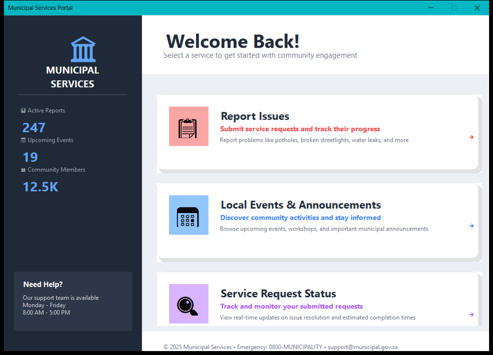
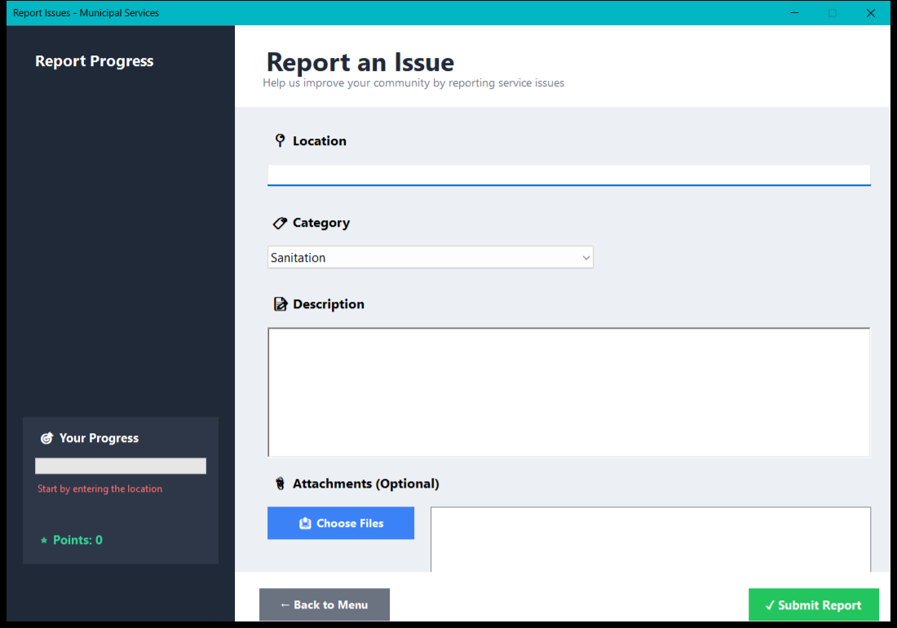
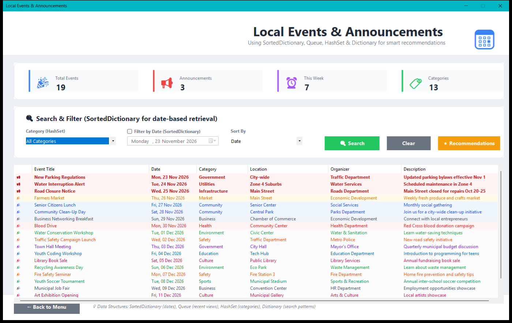
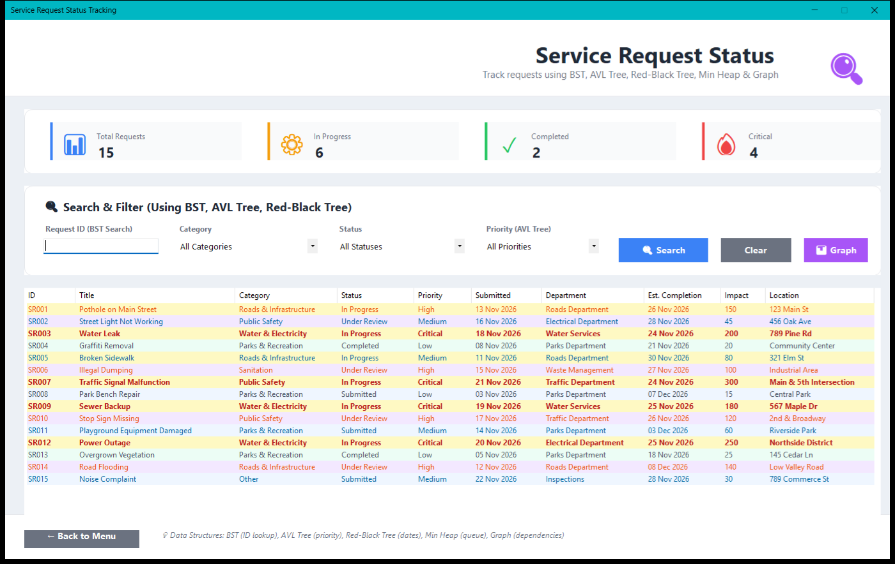

# Municipal Services Portal

A Windows desktop app that lets residents report municipal problems (potholes, water leaks, broken streetlights), browse local events and announcements, and track the status of service requests. Its core is a set of data structures I wrote from scratch in C#: a binary search tree, an AVL tree, a red-black tree, a min-heap and a weighted graph.

I built it for my Portfolio of Evidence in PROG7312 (Programming 3B), part of the BCA programme at The Independent Institute of Education (Varsity College).

> **Note:** This repository is a copy of my original submission repo, which is in the college's GitHub Classroom organisation. Students can't change repository visibility there, so I moved the project to my own account to make it public. The full commit history came across with it. The original work is dated November 2025, and the later commits are fixes I made when I came back to it.

    



---

## What it does

The app has three modules, each opened from the main menu.

### 1. Report Issues
Residents enter a location, pick a category, describe the problem and can attach photos or documents.
- Location and description are required, and the form says which one is missing.
- A progress bar fills as the form is completed, and each submitted report earns participation points.
- Reports are saved as XML in `Documents\MunicipalServicesReports\issues.xml`. Attachments are copied into an `attachments` folder next to it under unique names.
- A Windows tray notification confirms each submission.



### 2. Local Events & Announcements
Shows 19 sample events and announcements, with dates set relative to today so the list always looks current.
- Filter by category and/or date, and sort by date, category or name.
- **Recommendations** come from what you search for. The app counts searches per category and suggests upcoming events from your three most-searched categories. With no search history yet, it shows the next five upcoming events.
- Built on .NET collections chosen for each job: a `SortedDictionary` keeps events ordered by date, a `HashSet` holds the unique categories, a `Dictionary` counts searches, and a `Queue` keeps the last 10 events viewed.



### 3. Service Request Status
Lists 15 sample service requests with colour coding by status and priority.
- Look up a request by ID (binary search tree).
- Filter by category, status and priority.
- Select a request and click **Graph** to see the other requests it depends on, found with breadth-first search over the dependency graph.
- Double-click a request for its full details.



---

## The data structures

All five are hand-written generic classes in [`DataStructures/`](DataStructures). None of them wraps a built-in collection.

| Structure | File | Used for | Key operations |
|---|---|---|---|
| Binary search tree | [`BinarySearchTree.cs`](DataStructures/BinarySearchTree.cs) | Looking up a request by ID | Insert, search, in-order traversal, min/max |
| AVL tree | [`AVLTree.cs`](DataStructures/AVLTree.cs) | Priority index behind the statistics and priority queries | Self-balancing insert with all four rotation cases (LL, RR, LR, RL) |
| Red-black tree | [`RedBlackTree.cs`](DataStructures/RedBlackTree.cs) | Index of requests by submission date | Insert with recolouring and rotations, range query in O(log n + k) |
| Min-heap | [`MinHeap.cs`](DataStructures/MinHeap.cs) | Queue of open requests, most urgent first | Insert, extract-min, O(n) build-heap, peek |
| Graph (adjacency list) | [`ServiceRequestGraph.cs`](DataStructures/ServiceRequestGraph.cs) | Dependencies between requests, e.g. a sewer backup that depends on a water-leak repair | BFS, DFS, Dijkstra's shortest path, Kruskal's minimum spanning tree with union-find, cycle detection |

[`ServiceRequestManager.cs`](ServiceRequestManager.cs) puts every request into each structure and exposes the queries the UI uses.

---

## Tests

[`tests/MunicipalServicesReporting.Tests`](tests/MunicipalServicesReporting.Tests) holds 25 xUnit tests covering the data structures and the two manager classes. Some examples:
- an AVL tree given 1,023 keys in sorted order (the worst case for a plain BST) stays within the AVL height bound
- red-black tree in-order output stays sorted after 500 random inserts, and range queries return exactly the keys inside the range
- the heap extracts 200 random values in sorted order
- Dijkstra picks the cheaper two-hop path over a direct edge, and Kruskal skips the edge that would form a cycle

The data structures and managers don't depend on Windows Forms, so the test project compiles those source files directly and targets .NET 8. That means the tests also run on Linux. GitHub Actions runs them on every push and also builds the WinForms app on Windows.

```powershell
dotnet test tests/MunicipalServicesReporting.Tests
```

---

## Tech stack

| | |
|---|---|
| Language | C# 7.3 |
| Framework | .NET Framework 4.7.2, Windows Forms |
| UI | Built entirely in code (custom-painted cards, rounded panels, colour-coded list views), no designer files |
| Storage | XML serialisation for reported issues; events and service requests are in-memory sample data |
| Tests | xUnit on .NET 8 |
| CI | GitHub Actions |

## Project structure

```
├── Program.cs                    # Entry point, main menu, Report Issues form, issue repository (XML)
├── LocalEventsForm.cs            # Events & announcements screen
├── EventManager.cs / Event.cs    # Event storage, search, sorting, recommendations
├── ServiceRequestStatusForm.cs   # Service request tracking screen
├── ServiceRequestManager.cs      # Loads requests into every data structure and exposes queries
├── ServiceRequest.cs             # Request model, status and priority enums
├── DataStructures/               # BST, AVL tree, red-black tree, min-heap, graph
├── tests/                        # xUnit test project
└── docs/screenshots/
```

## Running it locally

**Requirements:** Windows 10/11 and Visual Studio 2019 or later with the ".NET desktop development" workload, which includes the .NET Framework 4.7.2 targeting pack.

1. Clone the repo and open `MunicipalServicesReporting.sln`.
2. Press **F5**.

From the command line instead, using a Visual Studio Developer PowerShell:

```powershell
msbuild MunicipalServicesReporting.csproj /p:Configuration=Release
```

```powershell
.\bin\Release\MunicipalServicesReporting.exe
```

The app creates `Documents\MunicipalServicesReports\` the first time it runs. Delete that folder to clear any saved reports.

## What I'd improve next

- **Connect the modules.** Reports submitted in Report Issues are saved, but the Service Request Status screen still shows built-in sample requests. The next step is to turn each saved report into a tracked request with an ID.
- **Use more of the graph in the UI.** DFS, Dijkstra, the minimum spanning tree and cycle detection are implemented and tested, but only BFS is exposed on screen.
- **Replace placeholder figures.** The sidebar numbers on the main menu (247 reports, 12.5K members) are decorative and not calculated.
- **Port to .NET 8 WinForms.** It would bring the app onto a supported modern runtime and allow per-monitor DPI scaling.
- **Use a database** such as SQLite instead of XML, so reports can be queried and updated.

## Changes since submission

When I revisited the project in November 2026, I checked that it still builds and runs, and I fixed the following:
- Labels containing "&" (e.g. "Local Events & Announcements") showed the ampersand as a blank, because Windows Forms treats it as a keyboard-shortcut marker.
- The icons on the statistics cards covered the first letter of each label ("otal Events").
- Attachments were copied into storage as soon as they were picked, even if the report was never submitted. The saved report also recorded the original filename instead of the stored one, so it couldn't be linked back to its file.
- When "All categories" was the most-searched option, it took up one of the three slots used for recommendations.
- I added the unit test project, the CI workflow and a `.gitignore`, and removed the compiled `bin/`, `obj/` and `.vs/` folders from the repo.

## About

Built by **Charné Janse van Rensburg** (ST10089153), a BCA student at IIE Varsity College.

This repository was submitted for academic assessment for PROG7312 and is not licensed for commercial use.
